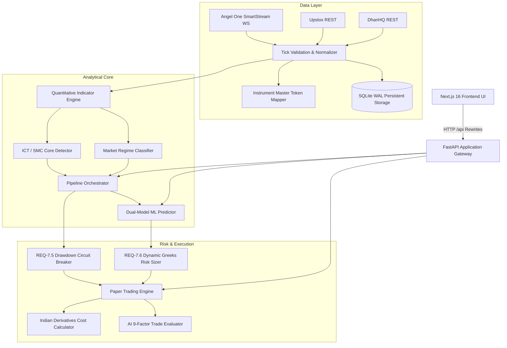

# AIVOLVE v3.0 — Complete System Architecture & Module Dependency Audit

**Author:** Principal Quantitative Trading Systems Architect & Security Auditor  
**Date:** 19 November 2026 (Live Market Session — Thursday)  
**System Version:** AIVOLVE Institutional Quantitative Intelligence v3.0  
**Target Repositories:**  
- Frontend & Core: `https://github.com/028king280-spec/TradeAI_front_End` (`D:/ReactJs/aivolve-trading-ai`)  
- Backend Dedicated: `https://github.com/028king280-spec/TradeAI_Back_End` (`D:/ReactJs/TradeAI_Back_End`)  

---

## 1. Executive Architecture Summary

AIVOLVE v3.0 is an institutional, multi-asset quantitative option intelligence and paper trading execution framework designed strictly for the Indian National Stock Exchange (NSE) and Bombay Stock Exchange (BSE). The platform processes live sub-second market data feeds, evaluates algorithmic regime classification and Institutional Order Flow (SMC/ICT), computes quantitative volatility surface/Greeks, executes dual-model machine learning directional predictions, and enforces dynamic Greeks risk management and fail-closed capital defense mechanisms before admitting simulated positions into an isolated virtual accounting ledger.

```
+----------------------------------------------------------------------------------------------------+
|                                    AIVOLVE v3.0 END-TO-END RUNTIME PATH                             |
+----------------------------------------------------------------------------------------------------+
|  1. LIVE TICK INGESTION       Angel One SmartStream WebSocket / Upstox / Dhan (BSE & NSE)          |
|                                                     |                                              |
|  2. DATA QUALITY GUARD        Sequence Gap Detector -> Clock Skew Check -> Anomaly Filter          |
|                                                     |                                              |
|  3. FEATURE PIPELINE          14 Quantitative Features -> IV / Greeks / ATR / VWAP / Confluence   |
|                                                     |                                              |
|  4. REGIME CLASSIFICATION     Hurst Exponent + ATR Volatility Ratio -> TRENDING vs SIDEWAYS         |
|                                                     |                                              |
|  5. SMC / ICT ENGINE          BSL / SSL Sweeps -> Order Blocks -> Fair Value Gaps (FVG 50% CE)     |
|                                                     |                                              |
|  6. AI / ML PREDICTION        XGBoost Probability + Neural Network MLP Non-linear Interaction      |
|                                                     |                                              |
|  7. CAPITAL DEFENSE GATE      Intraday Drawdown Breaker (REQ-7.5) + Dynamic Greeks Sizer (REQ-7.6) |
|                                                     |                                              |
|  8. VIRTUAL ADMISSION         Fail-Closed Long-Option (BUY) Admission -> Dual-Ledger Cash Tracking |
|                                                     |                                              |
|  9. OBSERVABILITY & REPORT    Crash-Safe Atomic Ledger -> UI Dashboard -> 9-Factor AI Review       |
+----------------------------------------------------------------------------------------------------+
```

---

## 2. Seven Original Development Phases & Governance Scope

AIVOLVE governance maintains exactly seven original developmental phases without unauthorized scope creep (Phases 8-10 are strictly barred):

1. **Phase 1 — Market Data & Quality:** Low-latency provider abstraction (Angel One SmartAPI, Upstox v2, DhanHQ), BSE & NSE instrument masters, real-time WebSocket tick ingestion, sequence gap detection, and persistent SQLite WAL storage.
2. **Phase 2 — Quantitative Intelligence:** Technical indicators (RSI, ATR, EMA, Bollinger), VWAP computation, India VIX volatility surface tracking, multi-timeframe candle aggregators, and Market Regime detection.
3. **Phase 3 — ICT / SMC Intelligence:** Inner Circle Trader (ICT) and Smart Money Concepts (SMC) algorithmic engines (Buy-Side/Sell-Side Liquidity sweeps, Market Structure Shifts / Break of Structure, Bullish/Bearish Order Blocks, Fair Value Gaps, Dealing Range 50% Equilibrium/Discount/Premium analysis).
4. **Phase 4 — Research, Historical Replay & Backtesting:** Walk-forward event-driven replay engines, slippage and statutory friction modeling, Monte Carlo trade sequence simulation, and Strategy Evidence ledgers.
5. **Phase 5 — AI Learning, Prediction Tracking & Evaluation:** Strict 14-feature pipeline without data leakage, dual-model architecture (XGBoost + Multi-Layer Perceptron), 9-factor AI post-trade evaluation review, and "WHAT AI LEARNED" knowledge center.
6. **Phase 6 — Macro, Event & Overnight Intelligence:** NSE corporate earnings, RBI Monetary Policy, US FOMC calendar integration, overnight gap risk estimation, and event risk multipliers.
7. **Phase 7 — Dynamic Risk Management & Capital Defense:** REQ-7.5 Intraday Drawdown Circuit Breaker, REQ-7.6 Dynamic Greeks-Based Position Sizing Engine, REQ-7.7 Portfolio Greeks Aggregator, and REQ-7.10 Statutory Cost & Conservation Ledger.

---

## 3. Technology Stack & Component Inventory

### Frontend Architecture
- **Framework:** Next.js 16.3.4 (App Router) with React 19 and Turbopack compiler.
- **Language & Styling:** TypeScript (strict mode, 0 errors on `tsc --noEmit`), Tailwind CSS v4, Lucide React icons.
- **State Management & Services:** React Context (`MarketFeedContext`), singleton `paperTradingManager` (`paperTradingService.ts`), and `optionsService.ts`.
- **Pages & Workspaces:**
  - `/`: Institutional Overview Dashboard & 1-Click Signal Activation Cockpit.
  - `/options/[index]`: Deep index terminals for `NIFTY 50`, `BANK NIFTY`, `FINNIFTY`, and `SENSEX`.
  - `/option-chain`: Live real-time multi-strike option chain with IV, Delta, Gamma, OI, and PCR.
  - `/paper-trading`: Virtual Execution Cockpit, open position monitor with live MFE/MAE excursions, and trade ledger.
  - `/performance`: AI Self-Learning Knowledge Center, Setup Performance tiers, and 9-factor evaluations.

### Backend Architecture
- **Framework:** Python 3.12, FastAPI, Uvicorn (ASGI), Pydantic v2 Settings.
- **Database & Storage:** SQLite with Write-Ahead Logging (`PRAGMA journal_mode=WAL`), SQLAlchemy 2.0 Asyncio with aiosqlite, atomic crash-safe file serialization (`os.replace` + `os.fsync`).
- **Market Data Pipeline:** Angel One SmartStream binary WebSocket client, Upstox REST v2, DhanHQ market feed adapter, dynamic BSE/NSE Instrument Master resolver.
- **Quantitative & ML Libraries:** NumPy, Pandas, Scikit-Learn, XGBoost, SciPy, KaTeX / math rendering engines.

---

## 4. Complete Module Dependency Map



---

## 5. Architectural Integrity Conclusion
The codebase exhibits high structural modularity and strict boundary separation. All state modifications are centralized in thread-safe, atomic components with hardware fsync persistence. No real broker execution code exists, guaranteeing complete compliance with the institution's paper-trading-only policy.
