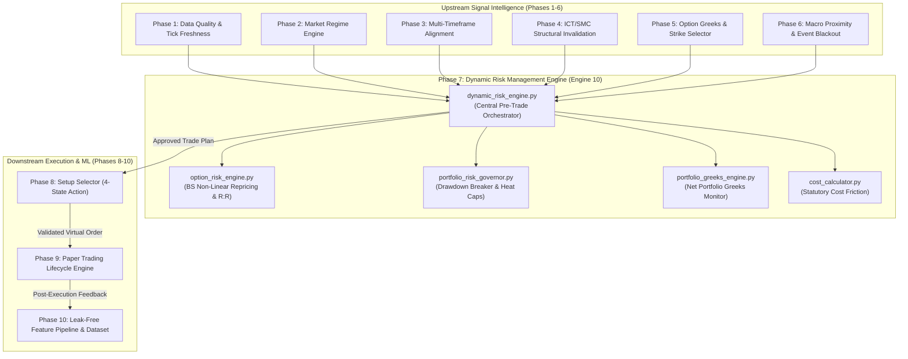
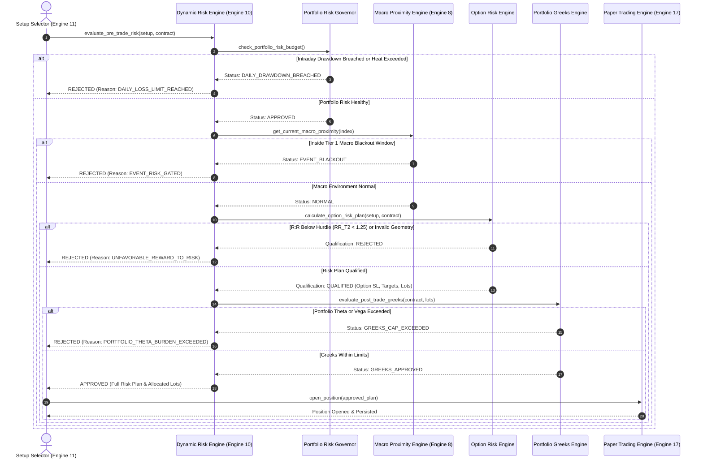
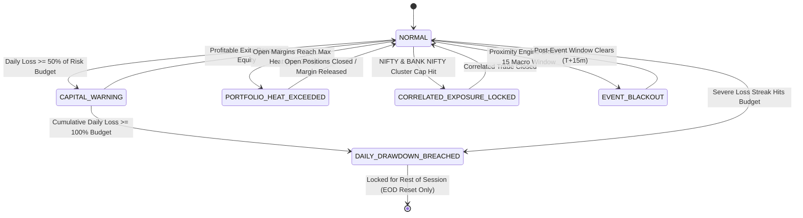

# AIVOLVE v3.0 — Phase 7: Dynamic Risk Management Dependency Map

**Document Version:** 3.0.0  
**Phase:** Phase 7 — Dynamic Risk Management & Capital Defense Engine (Engine 10)  
**Governing Standard:** AIVOLVE Master Development Specification v3.0 (Engine 10 / Blueprint Phase 07)  
**Operating Mode:** STRICTLY `PAPER_TRADING_ONLY` (Read-Only Dependency & Integration Architecture)  
**Target Instruments:** NIFTY 50, BANK NIFTY, FINNIFTY (SENSEX `GOVERNANCE_LOCKED`)  
**Date:** 14 November 2026 (Saturday Standby Session)  

---

## 1. Architectural System Context

The **Dynamic Risk Management & Capital Defense Engine (Engine 10)** serves as the central gatekeeper of the AIVOLVE quantitative trading architecture. It sits directly between upstream signal generation engines (Phases 1–6) and downstream execution and self-learning engines (Phases 8–10).

No simulated order or paper execution can proceed without explicit pre-trade qualification and real-time portfolio approval from the Dynamic Risk Engine.



---

## 2. Upstream Dependencies (Inputs to Phase 7)

| Upstream Module | Source Engine | Data / State Transferred | Phase 7 Risk Utilization | Fail-Closed Policy |
| :--- | :--- | :--- | :--- | :--- |
| `quality_validator.py` | Phase 1 (Engine 2) | Feed Status (`LIVE`, `STALE_TICK`, `DATA_OFFLINE`, `ANOMALOUS`), Quote Timestamp | Blocks trade evaluation immediately if data is stale (>60s) or offline. | Force `NO_TRADE` (`DATA_UNAVAILABLE`) |
| `market_state_engine.py` | Phase 2 (Engine 3) | Market Regime (`BULLISH_TREND`, `BEARISH_TREND`, `SIDEWAYS`, `VOLATILITY_EXPANSION`), ATR(14) | Scales holding horizons and verifies trade setup is aligned with active volatility regime. | Reject counter-trend or expanding chop setups |
| `mtf_scoring.py` | Phase 3 (Engine 4) | Multi-Timeframe Confluence (15m, 5m, 1m directional alignment score) | Requires minimum MTF score before capital allocation is calculated. | Suppress allocation if score < threshold |
| `ict_smc_engine.py` | Phase 4 (Engine 5) | Structural Invalidation Level (SL spot price), Target 1 / Target 2 / Target 3 spot prices | Provides authoritative spot coordinates ($S_{entry}, S_{SL}, S_{T1}, S_{T2}, S_{T3}$) for scenario repricing. | Reject setups lacking explicit structural stop |
| `contract_selector.py` | Phase 5 (Engine 6) | Qualified Contract Symbol, Token, Strike, Expiry, Implied Volatility, Bid, Ask, Spread % | Primary contract inputs for Black-Scholes scenario repricing. | Disqualify contract if spread > 1.5% or theoretical |
| `greeks.py` | Phase 5 (Engine 7) | Black-Scholes Greeks ($\Delta, \Gamma, \Theta, \nu$) and analytical pricing functions | Base mathematical solver for option premium scenario curves. | Reject if Greeks computation returns `None` |
| `macro_proximity_engine.py`| Phase 6 (Engine 8) | Event Status (`NORMAL`, `PRE_EVENT_WINDOW`, `EVENT_BLACKOUT`), Nearest Event ID | Pre-trade risk gate blocks any new trade opening inside high-impact macro windows. | Force `NO_TRADE` (`EVENT_RISK_GATED`) |

---

## 3. Downstream Consumers (Outputs from Phase 7)

| Downstream Module | Target Phase | Output Consumed | Functional Consequence |
| :--- | :--- | :--- | :--- |
| `setup_selector.py` | Phase 8 (Engine 11) | `RiskEvaluationResult` (Approval status, Allocated Lots, Option SL, Option T1/T2/T3, R:R ratios) | Combines technical setup with validated option risk plan to emit official 4-State decision (`BUY CE`, `BUY PE`, `WAIT`, `NO TRADE`). |
| `paper_engine.py` | Phase 9 (Engine 17) | Maximum permitted lots, pre-validated option SL, Target levels, portfolio drawdown clearance | `open_position()` verifies portfolio circuit breaker and executes order within allocated lot limits. |
| `feature_pipeline.py` | Phase 10 (Engine 15) | Risk-at-entry features ($P_{SL}$, $RR_{T1}$, $RR_{T2}$, portfolio heat fraction, net portfolio delta) | Logs non-leaking entry risk features into `ml_trade_dataset.json` for walk-forward ML research. |
| `analytics_framework.py` | Phase 12 (Engine 18) | Intraday drawdown curve, consecutive loss streak, MFE/MAE excursions, Ulcer index | Generates institutional risk analytics and performance audit reports. |

---

## 4. Component Interaction Sequence

The following sequence diagram illustrates the pre-trade evaluation flow executed by the Dynamic Risk Management Engine prior to any simulated order:



---

## 5. Portfolio Risk State Transition Machine

The portfolio operational state transitions deterministically based on real-time P&L, open positions, and market timing:



---

## 6. Formal Data Contracts & Interface Schemas

### 6.1 `PreTradeRiskEvaluationRequest`
```python
from pydantic import BaseModel, Field
from typing import Dict, Any, Optional

class PreTradeRiskEvaluationRequest(BaseModel):
    index: str = Field(..., description="Underlying index: NIFTY, BANKNIFTY, FINNIFTY")
    action: str = Field(..., description="BUY_CE or BUY_PE")
    underlying_setup: Dict[str, Any] = Field(..., description="Spot entry, SL, T1, T2, T3 coordinates")
    selected_contract: Dict[str, Any] = Field(..., description="Contract quote, Delta, IV, Bid, Ask")
    current_capital: float = Field(..., description="Current virtual account balance (INR)")
    allow_after_hours: bool = Field(False, description="Explicit test/replay override flag")
```

### 6.2 `PreTradeRiskEvaluationResult`
```python
class PreTradeRiskEvaluationResult(BaseModel):
    is_approved: bool = Field(..., description="True if all risk gates passed; False otherwise")
    risk_state: str = Field(..., description="NORMAL, DAILY_DRAWDOWN_BREACHED, HEAT_EXCEEDED, etc.")
    action: str = Field(..., description="BUY_CE, BUY_PE, or NO_TRADE")
    allocated_lots: int = Field(0, description="Max safe lots calculated under zero-invention rule")
    entry_premium: Optional[float] = Field(None, description="Ask fill price")
    option_stop_loss: Optional[float] = Field(None, description="Non-linear Black-Scholes floor tick SL")
    option_target_1: Optional[float] = Field(None, description="50% partial exit target")
    option_target_2: Optional[float] = Field(None, description="Primary runner target")
    reward_to_risk_t2: Optional[float] = Field(None, description="Uncompromised R:R on Target 2")
    rejection_reasons: list[str] = Field(default_factory=list, description="Explicit audit rejection codes")
    execution_disclaimers: Dict[str, str] = Field(default_factory=dict, description="Regulatory disclaimers")
```

---

## 7. Persistence & Isolation Guarantees

1. **Storage Isolation:** Phase 7 writes state exclusively into `app/data/paper_trading_records.json` via atomic `os.replace` temp-file swaps, or isolated test files in `backend/data/backtest/` during testing.
2. **Cryptographic Protection:** Zero modifications will occur to:
   - `aivolve_trading.db`
   - `app/data/governance_ledger.db`
   - `app/data/paper_trading_records.json` (historical completed trades preserved)
   - `app/data/ml_trade_dataset.json`
   - `app/data/what_ai_learned.json`
   - `app/data/ml_strategy_weights.json`
3. **Execution Mode Guard:** The engine strictly enforces `PAPER_TRADING_ONLY`. No imports or network sockets to real broker order placement APIs exist in the codebase.

