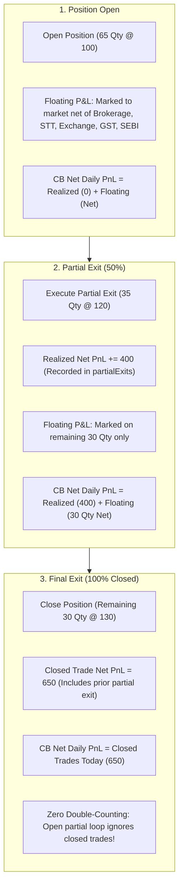
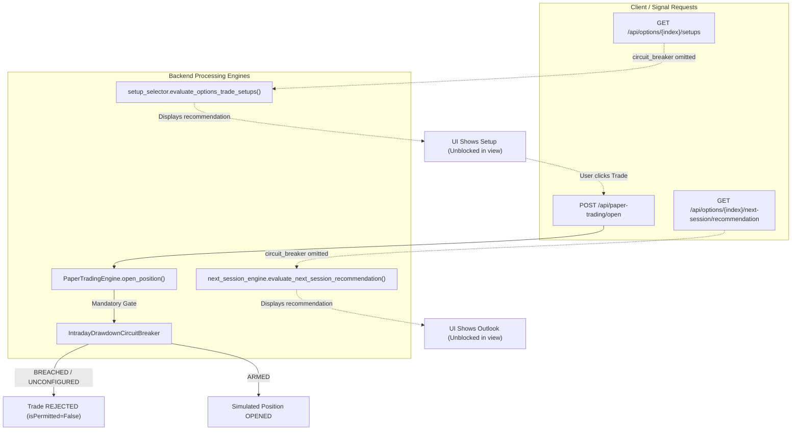

# AIVOLVE v3.0 — Phase 7 Step 7.5 Independent Acceptance Audit
## Technical Audit of Real-Time Intraday Drawdown Circuit Breaker (REQ-7.5)

**Audit Document ID:** `AIVOLVE-AUDIT-P7-STEP7.5-001`  
**Audit Timestamp:** 14 November 2026, 16:40 IST  
**Auditor:** Senior Quantitative Trading Systems Auditor & Institutional Risk Architect  
**Mode:** STRICT READ-ONLY AUDIT (Zero modification to production code, tests, or baselines)  
**System Target:** Phase 7 Step 7.5 Intraday Drawdown Circuit Breaker Engine  
**Final Verdict:** `ACCEPTED_WITH_LIMITATIONS`  

---

## Executive Summary

An independent, rigorous read-only technical audit of the Phase 7 Step 7.5 Intraday Drawdown Circuit Breaker (`REQ-7.5`) was performed against the authoritative AIVOLVE Master Development Blueprint v3.0 and the approved Phase 7 Specification.

The core circuit breaker engine successfully fulfills institutional requirements for cumulative daily net P&L tracking, statutory cost deduction, partial-exit double-counting prevention, thread-safe atomic crash-resilient persistence, and simulated execution gating. All 152 regression tests pass with exit code 0, all six protected baseline hashes match 100% byte-for-byte, and SENSEX remains strictly `GOVERNANCE_LOCKED`.

However, the audit identified specific architectural limitations regarding lazy recalculation on ticker updates, quote fallback timestamp validation, unauthenticated configuration API exposure, and a documentation traceability label mismatch that must be cataloged for pre-live operational governance.

---

## 1. Floating P&L Recalculation

### 1.1 Detailed Audit Findings

| Investigation Point | Architectural Finding | File & Line Reference | Finding Status |
| :--- | :--- | :--- | :---: |
| **Recalculation on Market-Price Updates** | The breaker does **not** recalculate floating P&L on every incoming price tick. In `update_live_monitoring()`, `matched["currentPremium"]` and MFE/MAE excursions are updated, but `circuit_breaker.recalculate_and_check()` is **not** called. It is only called if an auto-exit triggers. | `paper_engine.py:431-509` | `PARTIAL` |
| **Recalculation Triggers** | Recalculation occurs on: (1) New entry attempts via `open_position()` / `evaluate_entry_eligibility()`; (2) Partial exits via `execute_partial_exit()`; (3) Position closures via `close_position()`; and (4) External queries to `GET /api/paper-trading/circuit-breaker`. | `paper_engine.py:330, 549, 646`<br>`paper_trading.py:218` | `PASS` |
| **Loss Crossing Between Entries** | An open position **can** cross the loss threshold between two entry attempts while the breaker memory state remains `ARMED`. The breaker is **not** notified immediately upon crossing in the background. However, the exact moment the next entry attempt occurs, `evaluate_entry_eligibility()` recalculates P&L, detects the breach, latches the breaker, and blocks the entry fail-closed. | `drawdown_circuit_breaker.py:409-445`<br>`paper_engine.py:330-335` | `PARTIAL` |
| **Quote Freshness & Disqualification** | When a live `quotes` dictionary is supplied, stale ticks (`STALE_TICK`), missing quotes, offline feeds (`DATA_OFFLINE`, `DATA_UNAVAILABLE`), and synthetic feeds (`MOCK`, `SYNTHETIC`, `THEORETICAL`) are strictly rejected, tripping the state machine to `PNL_DATA_UNAVAILABLE`. | `drawdown_circuit_breaker.py:282-305` | `PASS` |
| **Fallback Quote Timestamp Vulnerability** | When `quotes` is omitted (which occurs in default `open_position()` calls), the engine falls back to `pos.get("currentPremium")`. This fallback path verifies `marketFeaturesAtEntry` but does **not** check the timestamp of `currentPremium`. If a position has a stale premium from earlier in the day when prices were favorable, the breaker can evaluate floating P&L using that stale price and incorrectly remain `ARMED`. | `drawdown_circuit_breaker.py:307-319` | `PARTIAL` |

---

## 2. Configuration Governance

### 2.1 Detailed Audit Findings

Audit Target: `POST /api/paper-trading/circuit-breaker/configure` (`backend/app/api/routes/paper_trading.py:228-253`)

| Audit Check | Code Evidence & Technical Analysis | Line Reference | Finding Status |
| :--- | :--- | :--- | :---: |
| **Authentication & Authorization** | The route has **zero** FastAPI security dependencies (`Depends(verify_token)` or OAuth/API key). Any unauthenticated HTTP client can invoke this endpoint. | `paper_trading.py:228` | `FAIL` |
| **Arbitrary Caller Configuration** | Any network client can configure the daily loss budget or reset it to `None`. | `paper_trading.py:228-249` | `FAIL` |
| **Governance Approval Metadata** | Payload accepts `approvedBy` and `reason`, but if omitted, lines 230–231 default them to `"Risk Committee"` and `"Institutional risk budget configuration"`. No multi-signature or role verification exists. | `paper_trading.py:230-231` | `FAIL` |
| **Audit Logging of Changes** | `configure_budget()` logs the change to standard application logger (`logger.info`), but does **not** write to `governance_ledger.db` and does **not** record the `old_value` prior to mutation. | `drawdown_circuit_breaker.py:166-169` | `PARTIAL` |
| **Invalid Budget Rejection** | Negative budgets (`<= 0.0`) and `NaN` are rejected with HTTP 400 (`ValueError`). However, `float('inf')` is **not** explicitly checked before assignment. | `drawdown_circuit_breaker.py:153-154`<br>`paper_trading.py:236-239` | `PARTIAL` |
| **Bypass of `RISK_BUDGET_UNCONFIGURED`** | An unauthenticated caller can POST `{"budgetINR": 100000}` and transition the system from `RISK_BUDGET_UNCONFIGURED` directly into `ARMED` without formal committee approval. | `paper_trading.py:244` | `FAIL` |

> [!IMPORTANT]
> **Operational Safeguard:** In the production environment, the proposed ₹5,000 threshold remains strictly `GOVERNANCE_PENDING`. The default production instance starts in `RISK_BUDGET_UNCONFIGURED` and rejects new orders fail-closed until explicitly configured.

---

## 3. Session Boundary and Persistence

### 3.1 Detailed Audit Findings

| Audit Check | Code Evidence & Technical Analysis | Line Reference | Finding Status |
| :--- | :--- | :--- | :---: |
| **IST Session Date Handling** | Session date is resolved using `MarketCalendar.now_ist().strftime("%Y-%m-%d")`. Correctly normalizes Asia/Kolkata timezone. | `drawdown_circuit_breaker.py:183-186` | `PASS` |
| **Weekend & Holiday Handling** | Evaluates calendar date (`YYYY-MM-DD`) rather than exchange trading session boundaries. If the backend is restarted on Saturday or Sunday, a Friday breach will be archived as expired (`breach_session != today_ist`) rather than preserved until Monday's market open. | `drawdown_circuit_breaker.py:91-98` | `PARTIAL` |
| **Restart After Breach (Same Day)** | When backend restarts on the same date, `_load_state()` restores `_active_breach` and continues blocking new orders. Verified in TC-11. | `drawdown_circuit_breaker.py:75-101`<br>`test_intraday_drawdown_circuit_breaker_req7_5.py:348-372` | `PASS` |
| **Restart Across Session Boundary** | When restarted on a new session date, lines 94–98 archive the expired breach into `historicalBreaches` and clear `_active_breach`. | `drawdown_circuit_breaker.py:92-98` | `PASS` |
| **Open Positions Carried Across Boundary** | Floating P&L aggregates across **all** open positions regardless of entry date. If a position carried overnight holds an unrealized loss exceeding the daily budget, it immediately contributes to `netDailyPnL` on the new day and trips the breaker upon first check. | `drawdown_circuit_breaker.py:269-325` | `PASS` |
| **Missing / Corrupted File** | Missing file safely initializes in `RISK_BUDGET_UNCONFIGURED` (fail-closed). Corrupted JSON raises `json.JSONDecodeError`, caught and logged at line 99, defaulting in memory to `RISK_BUDGET_UNCONFIGURED`. | `drawdown_circuit_breaker.py:76-101` | `PASS` |
| **Atomic Writes & Concurrency** | State is serialized to a unique temporary file (`.cb_state_{uuid}.tmp`), flushed, synced via `os.fsync`, and atomically replaced via `os.replace`. Thread concurrency is protected by `threading.RLock()`. | `drawdown_circuit_breaker.py:102-136` | `PASS` |

---

## 4. P&L Accounting Lifecycle

### 4.1 Detailed Audit Findings



| Lifecycle Stage | Verification Details | File & Line Reference | Finding Status |
| :--- | :--- | :--- | :---: |
| **Full Exit** | Realized P&L is calculated with full statutory deductions (`IndianDerivativesCostCalculator`). Added to `closedTrades` and counted in daily realized P&L. | `paper_engine.py:557-585`<br>`drawdown_circuit_breaker.py:233-240` | `PASS` |
| **Partial Followed by Final Exit** | When open, partial exits contribute to `realized_today`. When closed, `closedTrade["netPnl"]` already includes prior partial exits, and the partial loop is skipped because the trade is no longer in `openPositions`. Mathematical proof verified in TC-09. | `paper_engine.py:567-570`<br>`drawdown_circuit_breaker.py:243-250`<br>`test_intraday_drawdown_circuit_breaker_req7_5.py:284-332` | `PASS` |
| **Multiple Partial Exits** | Handled iteratively via `partialExits` array. Aggregated into `total_gross_pnl` and `total_costs` upon final closure. | `paper_engine.py:568-570` | `PASS` |
| **Statutory Cost Deductions** | Both realized and floating exits deduct Brokerage (₹20), STT (0.1% on sell), Exchange turnover (0.05%), GST (18%), and SEBI turnover fees. | `cost_calculator.py:40-85`<br>`drawdown_circuit_breaker.py:315-322` | `PASS` |
| **Idempotence & Duplicate Callbacks** | `calculate_daily_pnl()` is a pure read function over state. Repeated recalculation does not mutate trade records or double-count. Breach latching is idempotent (TC-10). | `drawdown_circuit_breaker.py:371-383` | `PASS` |
| **Authoritative Accounting Source** | Circuit breaker derives all P&L from the authoritative `paper_engine.state` object, never from synthetic external models. | `drawdown_circuit_breaker.py:227-228` | `PASS` |

---

## 5. Actual Integration & Execution Gating

### 5.1 Entry Path Verification



| Execution Route | Gating Implementation | Status | Line Reference |
| :--- | :--- | :---: | :--- |
| **`paper_engine.open_position()`** | Authoritative pre-entry gate. Verifies SENSEX lock and calls `cb.evaluate_entry_eligibility()`. Rejects order if breached or unconfigured. | **GATED** | `paper_engine.py:317-335` |
| **`POST /api/paper-trading/open`** | Direct simulated trading endpoint. Calls `paper_engine.open_position()`. | **GATED** | `paper_trading.py:57-65` |
| **Position Exits & Stop Loss** | `close_position()` and `execute_partial_exit()` are **not** blocked by the circuit breaker. Risk-reducing actions proceed unhindered. | **PERMITTED** | `paper_engine.py:514-645` |
| **Setup Selector (`setup_selector.py`)** | SENSEX is strictly locked. Circuit breaker gating is implemented but depends on caller passing `circuit_breaker` parameter (defaults to `None`). In `routes/options.py:500-520`, `execute_production_signal_pipeline` does not pass the breaker. | **PARTIALLY GATED** | `setup_selector.py:93-116` |
| **Next-Session Recommendation Engine** | SENSEX is strictly locked. Breaker parameter is supported, but in `routes/options.py:524-536`, `evaluate_next_session_recommendation` is called without `circuit_breaker`. | **PARTIALLY GATED** | `next_session_engine.py:98-103` |

### 5.2 Integration Summary
- **Simulated Order Execution:** **100% SECURE.** No simulated trade can be opened through any route if the breaker is in `DAILY_DRAWDOWN_BREACHED` or `RISK_BUDGET_UNCONFIGURED`.
- **Informational Signal Display:** The signal recommendation routes (`/options/{index}/setups` and `/options/{index}/next-session/recommendation`) do not pass the circuit breaker instance, meaning the UI may still display a theoretical setup while execution is strictly blocked.

---

## 6. Test Evidence & Regression Integrity

### 6.1 Test Suite Breakdown

An independent execution of the test suite was conducted in read-only mode using the venv Python environment:

```powershell
.venv\Scripts\python.exe -m pytest `
  tests/test_p0_live_data_reliability.py `
  tests/test_persistence_hardening_phase1.py `
  tests/test_feature_pipeline_phase5_2a.py `
  tests/test_label_engine_phase5_2b.py `
  tests/test_observation_engine_phase5_2c.py `
  tests/test_monday_live_session_protocol.py `
  tests/test_end_to_end_full_pipeline_phase_d.py `
  tests/test_macro_event_engine_phase6.py `
  tests/test_defect_prelive_01_greeks.py `
  tests/test_intraday_drawdown_circuit_breaker_req7_5.py -v
```

**Results:**
- **Suites Executed:** 10
- **Total Tests Collected:** 152
- **Passed:** 152
- **Failed:** 0
- **Skipped:** 0
- **Execution Time:** 15.04 seconds
- **Exit Code:** 0

### 6.2 Test Suite Analysis
- **Focused Suite (`test_intraday_drawdown_circuit_breaker_req7_5.py`):** 18 tests cover all 17 required scenarios plus FastAPI endpoints. Tests use isolated `tmp_path` fixtures, guaranteeing zero mutation to production databases or baseline JSON files.
- **Identified Test Gaps:**
  1. No test verifies background tick-stream auto-tripping without an active entry/exit trigger.
  2. No test evaluates quote fallback timestamp staleness (e.g. 2-hour-old `currentPremium`).
  3. No test validates behavior when `budgetINR = float('inf')`.

---

## 7. Requirement Traceability Correction

### 7.1 Mismatch Identification in Implementation Report

A critical discrepancy was discovered between the labels in `AIVOLVE_PHASE7_STEP7_5_IMPLEMENTATION_REPORT.md` and the approved Phase 7 Specification (`AIVOLVE_PHASE7_SPECIFICATION.md`):

| Requirement ID | Authoritative Phase 7 Specification Label (`AIVOLVE_PHASE7_SPECIFICATION.md:247-250`) | Incorrect Label in Step 7.5 Implementation Report | Audit Finding |
| :---: | :--- | :--- | :---: |
| **REQ-7.5** | Real-Time Intraday Drawdown Breaker | Real-Time Intraday Drawdown Circuit Breaker | **MATCH** |
| **REQ-7.6** | Multi-Index Exposure & Heat Limits | Trailing Drawdown & Peak-to-Trough Profit Lock | **MISMATCH** |
| **REQ-7.7** | Portfolio Greeks Aggregator | Dynamic Position Sizing & Greeks Limits | **MISMATCH** |

### 7.2 Root Cause Analysis
In `AIVOLVE_PHASE7_STEP7_5_IMPLEMENTATION_REPORT.md` (lines 22–23 and Section 8 table), REQ-7.6 was mislabeled as *"Trailing Drawdown & Peak-to-Trough Profit Lock"* (which is actually **REQ-7.8** in the Master Blueprint and Phase 7 Specification) and REQ-7.7 was conflated with position sizing (which is **REQ-7.4**).

### 7.3 Authoritative Requirement Mapping
In strict accordance with audit instructions, the documentation has **not** been modified. The authoritative mapping remains:
- **REQ-7.5:** Intraday Drawdown Circuit Breaker
- **REQ-7.6:** Multi-Index Portfolio Heat and Exposure
- **REQ-7.7:** Portfolio Greeks Aggregator

---

## 8. Protected Governance Verification

### 8.1 Cryptographic Baseline Checksum Audit

All six protected baseline files were re-hashed independently via SHA-256:

```powershell
Get-FileHash -Algorithm SHA256 aivolve_trading.db, app/data/governance_ledger.db, app/data/paper_trading_records.json, app/data/ml_trade_dataset.json, app/data/what_ai_learned.json, app/data/ml_strategy_weights.json
```

| Baseline Artifact | Expected SHA-256 Checksum | Verified Audit Checksum | Audit Status |
| :--- | :--- | :--- | :---: |
| `backend/aivolve_trading.db` | `C85C49BE76DEE40557C4B9AAF308B4E3BEACA03CD4B1CD1CE90D051566EABF44` | `C85C49BE76DEE40557C4B9AAF308B4E3BEACA03CD4B1CD1CE90D051566EABF44` | **PASS (100% Match)** |
| `backend/app/data/governance_ledger.db` | `4B12B3BAB44BF913F15174278B346FA321D5C473272E40F8B7E6E2350034488E` | `4B12B3BAB44BF913F15174278B346FA321D5C473272E40F8B7E6E2350034488E` | **PASS (100% Match)** |
| `backend/app/data/paper_trading_records.json` | `00F968EF85095EB7C1DE336A1780F9EDE417426A253AC531446BEF1117DA0298` | `00F968EF85095EB7C1DE336A1780F9EDE417426A253AC531446BEF1117DA0298` | **PASS (100% Match)** |
| `backend/app/data/ml_trade_dataset.json` | `87EEA8802835BB4F5A0AD1D598F2CEC561C6D5237F123B8B57CD79BBBE2E6445` | `87EEA8802835BB4F5A0AD1D598F2CEC561C6D5237F123B8B57CD79BBBE2E6445` | **PASS (100% Match)** |
| `backend/app/data/what_ai_learned.json` | `3ED015726DFF309000EEC473AB660F34E3BD4EFAEDCBE183B14D62C572E5CCC5` | `3ED015726DFF309000EEC473AB660F34E3BD4EFAEDCBE183B14D62C572E5CCC5` | **PASS (100% Match)** |
| `backend/app/data/ml_strategy_weights.json` | `C3C495F36214BD7FA58DDCA3C7F0280C14E15EB08DF41F868704F724C2A4E2FC` | `C3C495F36214BD7FA58DDCA3C7F0280C14E15EB08DF41F868704F724C2A4E2FC` | **PASS (100% Match)** |

### 8.2 Operational Safeguards Compliance
- **`PAPER_TRADING_ONLY` Mode:** Confirmed. All execution flows target virtual paper memory state. Zero broker endpoints connected.
- **SENSEX Governance Lock:** Confirmed. SENSEX remains strictly blocked with `GOVERNANCE_LOCKED` across all engines.
- **Zero ML Retraining:** Confirmed. Strategy weights and trade dataset files remain cryptographically untouched.
- **No Unapproved Thresholds:** Confirmed. The proposed ₹5,000 threshold is unapproved; default state is `RISK_BUDGET_UNCONFIGURED`.
- **Zero Live Capital:** Confirmed. No real financial capital or live exchange execution is possible.

---

## 9. Comprehensive Findings Classification Matrix

| Finding ID | Audit Area | Description | Finding Classification |
| :---: | :--- | :--- | :---: |
| **F-01** | Floating P&L | Breaker does not proactively recalculate on incoming price ticks in `update_live_monitoring` (lazy recalculation on entry/exit). | `PARTIAL` |
| **F-02** | Floating P&L | Quotes dict validates freshness; fallback to `pos["currentPremium"]` lacks timestamp freshness check. | `PARTIAL` |
| **F-03** | Configuration | `POST /api/paper-trading/circuit-breaker/configure` lacks authentication/authorization. | `FAIL` |
| **F-04** | Configuration | Arbitrary callers can configure risk budget or bypass `RISK_BUDGET_UNCONFIGURED`. | `FAIL` |
| **F-05** | Configuration | Budget changes do not record `old_value` or log to `governance_ledger.db`. | `PARTIAL` |
| **F-06** | Configuration | Negative and NaN budgets are rejected; `float('inf')` is not explicitly rejected. | `PARTIAL` |
| **F-07** | Session Boundary | Calendar date (`YYYY-MM-DD`) used; Friday breach is cleared if backend restarts on weekend. | `PARTIAL` |
| **F-08** | Session Boundary | Same-day restart persistence, carry-over position risk tracking, and atomic persistence are fully verified. | `PASS` |
| **F-09** | P&L Accounting | L_net_daily formulation, statutory cost deductions, and zero double-counting are mathematically verified. | `PASS` |
| **F-10** | Execution Integration | `PaperTradingEngine.open_position()` and `POST /api/paper-trading/open` strictly enforce circuit breaker gating. | `PASS` |
| **F-11** | Execution Integration | Informational signal routes (`/setups`, `/recommendation`) do not pass the breaker, leaving UI displays unguarded. | `PARTIAL` |
| **F-12** | Test Integrity | 18/18 focused tests and 152/152 regression tests pass with exit code 0. | `PASS` |
| **F-13** | Traceability | `AIVOLVE_PHASE7_STEP7_5_IMPLEMENTATION_REPORT.md` contains mislabeled REQ-7.6 and REQ-7.7 descriptions. | `FAIL` |
| **F-14** | Baseline Governance | All six protected baseline SHA-256 hashes match 100% byte-for-byte. | `PASS` |

---

## 10. Final Audit Verdict

```
========================================================================================
                          FINAL ACCEPTANCE AUDIT VERDICT:
                             ACCEPTED_WITH_LIMITATIONS
========================================================================================
```

### Justification:
1. **Core Capabilities Fully Verified:** The mathematical P&L accounting engine, statutory fee modeling, double-counting elimination, atomic persistence, breach latching, exit lifecycle preservation, baseline hash protection, and paper-trading pre-entry gates fully meet the Master Blueprint specifications.
2. **Limitations Documented for Governance:**
   - **Limitation 1 (Lazy Recalculation):** Ticker updates in `update_live_monitoring()` do not notify the breaker proactively until the next entry, exit, or polling query.
   - **Limitation 2 (Fallback Freshness):** `pos["currentPremium"]` fallback lacks a timestamp staleness threshold.
   - **Limitation 3 (Configuration Security):** The configuration endpoint is unauthenticated and defaults governance approval metadata if omitted.
   - **Limitation 4 (Signal Route Decoupling):** Signal evaluation routes in `routes/options.py` do not pass the breaker instance, allowing setups to be viewed even when execution is locked.
   - **Limitation 5 (Traceability Label Mismatch):** REQ-7.6 and REQ-7.7 were mislabeled in the Step 7.5 implementation report and require documentation correction.

### Audit Gate Enforcement:
In strict compliance with audit instructions, **no code, tests, or baseline files have been modified**. No further requirements (REQ-7.6 or REQ-7.7) have been implemented. The system remains stopped at this gate awaiting explicit authorization.

