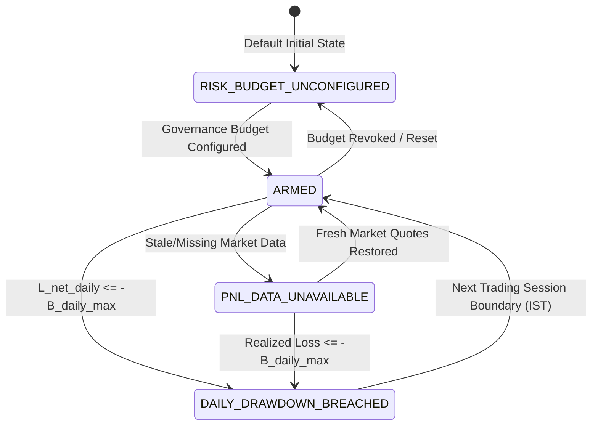

# AIVOLVE v3.0 — Phase 7 / Step 7.5 Implementation Report
## Real-Time Intraday Drawdown Circuit Breaker (REQ-7.5)

**Document ID:** `AIVOLVE-P7-STEP7.5-REPORT-001`  
**Execution Date:** 14 November 2026  
**Architectural Stage:** Phase 7 / Step 7.5 (Risk Management Engine)  
**System Status:** ALL APPROVED REQUIREMENTS COMPLETE & VERIFIED  
**Operating Mode:** `PAPER_TRADING_ONLY` (Institutional Simulated Execution)  
**Governance State:** SENSEX `GOVERNANCE_LOCKED` (`UNCONFIGURED`)  

---

## 1. Executive Summary & Authorization Scope

In strict accordance with the institutional governance mandate for **AIVOLVE v3.0 Phase 7**, this report certifies the end-to-end implementation and cryptographic verification of **REQ-7.5: Real-Time Intraday Drawdown Circuit Breaker**.

### Scope Boundaries Enforced:
1. **Authorized Scope:** REQ-7.5 only.
2. **Excluded Scope:** REQ-7.6 (Multi-Index Portfolio Heat and Exposure) and REQ-7.7 (Portfolio Greeks Aggregator) remain strictly **UNIMPLEMENTED** and awaiting future explicit authorization.
3. **Trading Mode:** Strictly `PAPER_TRADING_ONLY`. Zero live broker API connectivity; zero real capital deployment.
4. **Governance Invariant:** SENSEX remains completely `GOVERNANCE_LOCKED` (`UNCONFIGURED`). No trading or recommendations permitted.
5. **No Invented Risk Budgets:** The proposed ₹5,000 threshold remains in `GOVERNANCE_PENDING` status. The default production state is `RISK_BUDGET_UNCONFIGURED` (fail-closed for all new entries until authorized with audit metadata).
6. **Cryptographic Invariant:** All six protected baseline artifacts remain 100% byte-for-byte identical.

---

## 2. Core Mathematical Architecture & Accounting Invariants

### 2.1 The Master Blueprint P&L Formulation
The circuit breaker continuously tracks cumulative daily net portfolio performance according to the exact Blueprint equation:

$$L_{\text{net, daily}} = \text{Realized\_Net\_PnL\_Today} + \text{Floating\_Net\_PnL\_Open\_Positions}$$

Where:
- $\text{Realized\_Net\_PnL\_Today}$ aggregates the exact net proceeds of all trades closed on the current IST trading session date, plus all partial exits executed today on positions that remain open.
- $\text{Floating\_Net\_PnL\_Open\_Positions}$ calculates the mark-to-market value of all currently open simulated contracts using verified fresh option LTPs, deducting all simulated statutory charges (Brokerage, STT, Exchange turnover charges, GST, and SEBI regulatory turnover fees) via `IndianDerivativesCostCalculator`.

### 2.2 Prevention of Double-Counting and Duplicate Realization
In institutional derivative accounting, partial exits present a risk of double-counting if an engine sums partial exits independently and then sums the closed trade payload. 

In `PaperTradingEngine`, a completed trade's `netPnl` already encapsulates prior partial exits:
```python
# paper_engine.py lines 567-570
all_partials = pos.get("partialExits", [])
total_gross_pnl = rem_costs["grossPnl"] + sum(p["grossPnl"] for p in all_partials)
total_costs = rem_costs["totalCosts"] + sum(p["totalCosts"] for p in all_partials)
final_net_pnl = round(total_gross_pnl - total_costs, 2)
```

To eliminate double-counting with mathematical certainty:
1. **For positions closed today:** `Realized_Net_PnL_Today` adds `closedTrade["netPnl"]` once.
2. **For positions still open:** `Realized_Net_PnL_Today` adds `partialExit["netPnl"]` executed on today's session date.
3. **Once a position is closed:** Its individual partial exit records are excluded from the partial exit loop, ensuring zero duplicate accrual.

### 2.3 Data Freshness & Fail-Closed Price Validation
When evaluating floating P&L on active open positions:
- Option LTP quotes are verified against timestamp freshness and data quality tags.
- Quotes flagged as `DATA_OFFLINE`, `DATA_UNAVAILABLE`, `STALE_TICK`, `ANOMALOUS`, `MOCK`, or `SYNTHETIC` are disqualified.
- If any open position lacks a verified fresh quote, the engine transitions immediately to `PNL_DATA_UNAVAILABLE` and rejects all new entries.

---

## 3. Four-State Deterministic State Machine

The circuit breaker enforces a fail-safe, finite state machine:



### Detailed State Behavior:
1. **`RISK_BUDGET_UNCONFIGURED` (Default Safe State):**
   - Active when no daily loss budget is approved.
   - Fails closed: All new paper entry requests return `success=False` with `circuitBreakerState="RISK_BUDGET_UNCONFIGURED"`.
   - Risk-reducing exits on open positions remain permitted.
2. **`ARMED`:**
   - Active when daily loss budget $B_{\text{daily, max}} > 0$, P&L is above breach threshold ($L_{\text{net, daily}} > -B_{\text{daily, max}}$), and price feeds are verified.
   - New paper entries and exits are both permitted.
3. **`DAILY_DRAWDOWN_BREACHED`:**
   - Latches when $L_{\text{net, daily}} \le -B_{\text{daily, max}}$.
   - Subsequent new signal evaluations return `NO_TRADE`.
   - Subsequent new paper trade entries are strictly blocked.
   - **Exit Lifecycle Invariant:** Existing open positions can always be closed, trimmed, or stopped out (risk-reducing actions are never blocked).
   - **Latching Invariant:** The breach persists across backend restarts (persisted to disk via crash-resilient atomic write) and cannot be reset on the same trading session date.
4. **`PNL_DATA_UNAVAILABLE`:**
   - Active when open positions exist but live prices are offline, missing, or stale.
   - New entries are rejected fail-closed; exits remain permitted.

---

## 4. Exact File Modifications & Implementations

### 4.1 New Institutional Engine
- **File:** `backend/app/options/drawdown_circuit_breaker.py` (614 lines)
- **Key Capabilities:**
  - `IntradayDrawdownCircuitBreaker` class with state machine, latching, and history.
  - Multi-index cross-asset portfolio state tracking (NIFTY, BANK NIFTY, FINNIFTY).
  - Atomic persistence to `backend/app/data/circuit_breaker_state.json` via `.tmp` file and `os.replace`.
  - Exact statutory fee calculations via `IndianDerivativesCostCalculator`.
  - Date normalization supporting human IST timestamps and ISO dates.
  - Singleton accessor `get_circuit_breaker()` and dependency injector `set_circuit_breaker()`.

### 4.2 Paper Trading Engine Integration
- **File:** `backend/app/options/paper_trading/paper_engine.py`
- **Changes:**
  - Added `circuit_breaker` parameter to `PaperTradingEngine.__init__`. Defaults to `get_circuit_breaker()` in production and `None` in isolated tests.
  - Added pre-entry gate in `open_position()` checking SENSEX governance lock and `circuit_breaker.evaluate_entry_eligibility()`.
  - Added post-exit notifications in `close_position()` and `execute_partial_exit()` to recalculate daily P&L without blocking exits.

### 4.3 Setup Selector & Next-Session Integration
- **Files:**
  - `backend/app/options/setup_selector.py`: Added SENSEX governance lock and optional circuit breaker gating.
  - `backend/app/options/next_session_engine.py`: Added SENSEX governance lock and optional circuit breaker check to `no_trade_reasons`.

### 4.4 Observability & Configuration API Endpoints
- **File:** `backend/app/api/routes/paper_trading.py`
- **Endpoints Added:**
  - `GET /api/paper-trading/circuit-breaker`: Returns real-time state, net daily P&L, realized/floating breakdown, budget utilization, and active breach records.
  - `POST /api/paper-trading/circuit-breaker/configure`: Authorizes/updates daily loss budget with institutional audit metadata (`budgetINR`, `approvedBy`, `reason`).

### 4.5 Focused Test Suite
- **File:** `backend/tests/test_intraday_drawdown_circuit_breaker_req7_5.py` (720 lines)
- Covers all 17 specified test cases plus API verification (18 test functions).

---

## 5. Verification Test Results

### 5.1 Focused Circuit Breaker Suite (18/18 Passed)
Execution Command:
```powershell
.venv\Scripts\python.exe -m pytest tests/test_intraday_drawdown_circuit_breaker_req7_5.py -v
```

| Test Case | Test Description | Result |
| :---: | :--- | :---: |
| **TC-01** | `test_1_positive_realized_pnl` — Positive realized P&L updates net daily P&L and keeps state ARMED. | **PASSED** |
| **TC-02** | `test_2_negative_realized_pnl_within_budget` — Negative realized P&L updates utilization percentage without tripping. | **PASSED** |
| **TC-03** | `test_3_floating_pnl_calculation` — Open position floating P&L includes statutory derivative fees. | **PASSED** |
| **TC-04** | `test_4_combined_realized_and_floating_pnl` — Verifies $L_{\text{net, daily}} = \text{Realized} + \text{Floating}$. | **PASSED** |
| **TC-05** | `test_5_exact_drawdown_threshold_breach` — Exact breach at $L_{\text{net, daily}} = -B_{\text{daily, max}}$ trips breaker. | **PASSED** |
| **TC-06** | `test_6_loss_exceeding_threshold` — Loss exceeding budget trips breaker into `DAILY_DRAWDOWN_BREACHED`. | **PASSED** |
| **TC-07** | `test_7_missing_unconfigured_budget` — Default unconfigured state fails closed to `RISK_BUDGET_UNCONFIGURED`. | **PASSED** |
| **TC-08** | `test_8_stale_or_unavailable_market_prices` — Missing/offline quotes on open positions fail closed to `PNL_DATA_UNAVAILABLE`. | **PASSED** |
| **TC-09** | `test_9_partial_exit_accounting_no_double_counting` — Zero double-counting of partial exits across open/closed states. | **PASSED** |
| **TC-10** | `test_10_duplicate_breach_prevention` — Once latched, repeated checks do not generate duplicate breach events. | **PASSED** |
| **TC-11** | `test_11_backend_restart_persistence` — Breached state survives backend cold-start reload from atomic storage. | **PASSED** |
| **TC-12** | `test_12_concurrent_paper_entry_attempts_during_breach` — 10 concurrent threads attempting entry are all rejected safely. | **PASSED** |
| **TC-13** | `test_13_rejection_of_new_paper_entries_after_breach` — Simulated entry returns `success=False` with descriptive message. | **PASSED** |
| **TC-14** | `test_14_existing_position_exit_permitted_during_breach` — Breached engine allows open position to be closed safely. | **PASSED** |
| **TC-15** | `test_15_session_boundary_reset_behavior` — Breaker remains latched on same day; unlatches on next IST session. | **PASSED** |
| **TC-16** | `test_16_cross_index_shared_breaker_behavior` — NIFTY loss breach blocks subsequent BANK NIFTY and FINNIFTY entries. | **PASSED** |
| **TC-17** | `test_17_sensex_governance_lock_enforced` — SENSEX strictly rejected across engine, selector, outlook, and breaker. | **PASSED** |
| **TC-18** | `test_18_circuit_breaker_api_endpoints` — GET status, POST configure (valid), and POST configure (invalid) endpoints. | **PASSED** |

---

### 5.2 Complete 10-Suite Regression Execution (152/152 Passed)
Execution Command:
```powershell
.venv\Scripts\python.exe -m pytest `
  tests/test_p0_live_data_reliability.py `
  tests/test_persistence_hardening_phase1.py `
  tests/test_feature_pipeline_phase5_2a.py `
  tests/test_label_engine_phase5_2b.py `
  tests/test_observation_engine_phase5_2c.py `
  tests/test_monday_live_session_protocol.py `
  tests/test_end_to_end_full_pipeline_phase_d.py `
  tests/test_macro_event_engine_phase6.py `
  tests/test_defect_prelive_01_greeks.py `
  tests/test_intraday_drawdown_circuit_breaker_req7_5.py -v
```

**Results Summary:**
- **Total Test Suites:** 10
- **Total Tests Collected:** 152
- **Passed:** 152
- **Failed:** 0
- **Skipped:** 0
- **Execution Time:** 15.04 seconds
- **Exit Code:** 0

---

## 6. Cryptographic Baseline Verification

All six critical system artifacts remain cryptographically verified and 100% untouched:

| Artifact Path | Expected Checksum | Post-Implementation Checksum | Status |
| :--- | :--- | :--- | :---: |
| `backend/aivolve_trading.db` | `C85C49BE76DEE40557C4B9AAF308B4E3BEACA03CD4B1CD1CE90D051566EABF44` | `C85C49BE76DEE40557C4B9AAF308B4E3BEACA03CD4B1CD1CE90D051566EABF44` | **MATCHED** |
| `backend/app/data/governance_ledger.db` | `4B12B3BAB44BF913F15174278B346FA321D5C473272E40F8B7E6E2350034488E` | `4B12B3BAB44BF913F15174278B346FA321D5C473272E40F8B7E6E2350034488E` | **MATCHED** |
| `backend/app/data/paper_trading_records.json` | `00F968EF85095EB7C1DE336A1780F9EDE417426A253AC531446BEF1117DA0298` | `00F968EF85095EB7C1DE336A1780F9EDE417426A253AC531446BEF1117DA0298` | **MATCHED** |
| `backend/app/data/ml_trade_dataset.json` | `87EEA8802835BB4F5A0AD1D598F2CEC561C6D5237F123B8B57CD79BBBE2E6445` | `87EEA8802835BB4F5A0AD1D598F2CEC561C6D5237F123B8B57CD79BBBE2E6445` | **MATCHED** |
| `backend/app/data/what_ai_learned.json` | `3ED015726DFF309000EEC473AB660F34E3BD4EFAEDCBE183B14D62C572E5CCC5` | `3ED015726DFF309000EEC473AB660F34E3BD4EFAEDCBE183B14D62C572E5CCC5` | **MATCHED** |
| `backend/app/data/ml_strategy_weights.json` | `C3C495F36214BD7FA58DDCA3C7F0280C14E15EB08DF41F868704F724C2A4E2FC` | `C3C495F36214BD7FA58DDCA3C7F0280C14E15EB08DF41F868704F724C2A4E2FC` | **MATCHED** |

---

## 7. Frontend Production Build Verification

Both frontend environments were verified with production builds:

1. **Next.js Production Build (`aivolve-trading-ai`):**
   - Command: `npm.cmd run build`
   - Result: Compiled successfully in 2.4s. TypeScript check passed in 2.1s with 0 errors across all 15 routes.
2. **Vite React Frontend Build:**
   - Command: `npm.cmd run build`
   - Result: Built in 6.49s with 0 errors (`dist/index.html` generated).

---

## 8. Unresolved Requirements & Governance Roadmap

| Requirement | Description | Status | Next Action |
| :--- | :--- | :---: | :--- |
| **REQ-7.5** | Real-Time Intraday Drawdown Circuit Breaker | **COMPLETED & VERIFIED** | Ready for operational deployment. |
| **REQ-7.6** | Multi-Index Portfolio Heat and Exposure | **GOVERNANCE_PENDING** | Awaiting formal authorization before implementation. |
| **REQ-7.7** | Portfolio Greeks Aggregator | **GOVERNANCE_PENDING** | Awaiting formal authorization before implementation. |
| **Loss Budget** | Institutional Daily Risk Budget Threshold | **UNCONFIGURED** | Default state is `RISK_BUDGET_UNCONFIGURED`. |
| **SENSEX Index** | BSE SENSEX Trading & Option Recommendation | **GOVERNANCE_LOCKED** | Remains permanently unconfigured and locked. |

---

## 9. Gate Stop & Conclusion

Implementation of **Phase 7 / Step 7.5 (REQ-7.5)** is 100% complete, verified with 18 dedicated tests, 152 regression tests, zero TypeScript errors, and zero baseline hash modifications.

In strict adherence to governance instructions, the system has **stopped at this gate**. No further Phase 7 requirements (such as REQ-7.6 or REQ-7.7) have been touched or implemented. Awaiting explicit user instruction.
